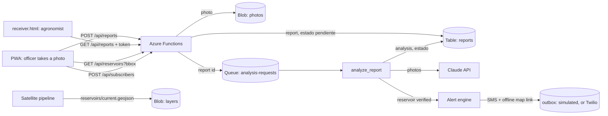

# Gusanito

Early detection of fall armyworm reservoirs: extension officers photograph green dry-season patches, the server analyses each photo with Claude and keeps the result for an agronomist to review. The project proposal is in [`docs/propuesta-gusano-cogollero.md`](docs/propuesta-gusano-cogollero.md).

```
frontend/   PWA (vanilla JS): map with reservoirs, photo report, receiver page, service worker, offline map, dev server
backend/    Azure Functions app (Python 3.13): reports, Claude analysis queue, reservoirs layer, subscribers, alert engine
infra/      Terraform: Function App (Flex Consumption), Storage, Key Vault, Application Insights, Static Web App
```



The PWA gets an acknowledgement as soon as the photo is stored and never sees Claude's answer. The analysis runs from a queue, so a slow or failing Claude call never makes the officer wait, and it is retried automatically.

## API

| Method | Route | Auth | What it does |
|---|---|---|---|
| GET | `/api/health` | none | `{"status": "ok"}` |
| GET | `/api/reservoirs?bbox=lon_min,lat_min,lon_max,lat_max` | none | Reservoirs layer (GeoJSON) for the visible map area, each feature with `confirmado` and `verificacion` (latest verified report's `estado`). 404 until the pipeline publishes one |
| POST | `/api/reports` | none | Stores a photo report and queues its analysis. 202 new, 200 if that `id` was already received |
| GET | `/api/reports[?reservoirId=]` | token | Reports, newest first |
| GET | `/api/reports/{id}` | token | One report |
| GET | `/api/reports/{id}/photos/{n}` | token | A report photo |
| POST | `/api/subscribers` | none | Registers a farmer for SMS alerts: `phone` (E.164), `location` of the maize field, `language` es/en/ny. 201 new, 200 updated (idempotent per phone) |
| POST | `/api/subscribers/unsubscribe` | none | `{"phone": ...}`: stops alerts. Same answer whether or not the number was registered |
| POST | `/api/alerts/message` | token | Drafts the SMS and voice script of an alert (`riskLevel`, `distanceKm`, `direction`, `daysToAct`, `language`: es/en/ny) |

"token" is `REPORT_TOKEN`, sent as the `x-report-token` header only, never in the URL, where it would land in request logs. The receiver page fetches photos with the header and shows them as blob URLs.

`POST /api/reports` body (camelCase, like the rest of the PWA's JSON):

```json
{
  "id": "0b6f6b8e-6a8f-4f0e-9a4f-2d0b1c3e4f50",
  "reservoirId": "lusaka-0007",
  "label": "armyworm",
  "location": {"lat": -15.4165, "lng": 28.2849, "accuracy": 8},
  "capturedAt": "2026-09-12T08:30:00+02:00",
  "photos": [{"mediaType": "image/jpeg", "data": "<base64>"}],
  "meta": {"name": "IMG_0001.jpg", "originalSize": 2400000, "width": 4032, "height": 3024}
}
```

Only `id` and 1-3 `photos` are required. `label` is what the officer picked: `armyworm`, `not_armyworm` or `unsure`. The PWA generates `id` per photo, so a resend after a dropped connection is never stored twice.

Claude's `analisis` answers yes or no and says how sure it is, with the evidence as structured fields (no free text):

```json
{"hay_plaga": true, "confianza": 0.85, "calidad_fotos": "buena", "tipo_vegetacion": "maiz",
 "es_hospedero": "si", "senales_gusano": ["hojas_ventana"], "severidad": "media"}
```

`confianza` is how sure Claude is of its `hay_plaga` answer, yes or no: near 1 when it clearly sees the pest or clearly sees it is not there, near 0 when it cannot tell. It is self-reported and not calibrated: tune `MIN_CONFIDENCE` with agronomist-labelled photos.

Report `estado`, set from the analysis:

| `estado` | When |
|---|---|
| `pendiente` | Waiting for the analysis |
| `reservorio_confirmado` | `hay_plaga` is true |
| `hospedero_sin_senales` | No pest, host vegetation |
| `descartado` | No pest, not a host |
| `revision_humana` | `confianza` below `MIN_CONFIDENCE` (0.7), Claude declined, or host unclear |
| `repetir_fotos` | Photos are unusable |
| `error_analisis` | The analysis failed 5 times, or failed with a non-retryable error |

`agrees` compares `hay_plaga` with the officer's label. `scene` (`{"id", "date", "bbox"}`) records the satellite scene the reservoir was mapped from, copied from the layer when the report arrives.

### Alerts

When a report about a reservoir is analysed, the queue function runs the alert engine (`backend/gusanito/alerts.py`) for that reservoir; `tools/run_alerts.py` runs it on demand (`--dry-run` prints who would get what). Subscribers within 10 km of a confirmed reservoir, or within 5 km of an unverified one with `probabilidad` >= 0.8, get one SMS: severity by distance band (2 / 5 / 10 km, reasoning in [`docs/distancia-alerta.md`](docs/distancia-alerta.md)), GSM-7 text in es/en/ny that fits 160 characters, and the offline link (`?p=`, `gusanito/smslink.py`) that draws the reservoirs in the installed PWA with no data. The same subscriber is not alerted about the same reservoir again within 14 days unless it got worse. A reservoir whose latest verified report found no larvae never alerts.

Every SMS is written to the `outbox` table (also the deduplication log). The default sender is simulated: nothing leaves the machine, and each message is appended to `backend/data/outbox.jsonl`. `SMS_SENDER=twilio` with `TWILIO_ACCOUNT_SID`, `TWILIO_AUTH_TOKEN` and `TWILIO_FROM` sends for real. `PWA_URL` is the link base; `ALERT_*` settings change the bands.

### Labels for the ML model

`tools/export_labels.py` writes `ml/data/labels.csv`, one row per verified report (`estado` `reservorio_confirmado`, `hospedero_sin_senales` or `descartado`):

| Column | Meaning |
|---|---|
| `report_id` | Report UUID |
| `reservoir_id` | Reservoir (layer feature `id`) the photo was about |
| `lat`, `lon` | Phone GPS of the report; the reservoir's centre when there was no GPS |
| `scene_id`, `scene_date` | Satellite scene of the layer the reservoir came from (`escena`, `fecha`) |
| `hay_plaga` | Claude's answer: larvae or damage seen (`True`/`False`) |
| `confianza` | Claude's self-reported confidence, 0-1 |
| `estado` | Report state (table above) |
| `label_source` | `claude` (the label comes from the photo analysis) |
| `officer_label` | What the officer picked: `armyworm`, `not_armyworm`, `unsure` or empty |
| `received_at` | When the server got the report (ISO 8601) |

It also writes `backend/data/fewshot/` (`examples.jsonl` + photos) with the reports where Claude and the officer agree: a store of examples the analysis prompt can use later (`analysis.py` does not use it yet).

### Reservoirs layer contract (satellite pipeline)

Publish a GeoJSON `FeatureCollection` to the blob `layers/reservoirs/current.geojson` in the storage account. Each feature's `id` is the reservoir id the PWA sends back (letters, digits, `-`, `_`, `.`), and `properties` holds at least `probabilidad` (0-1) and `fecha` (ISO date of the satellite scene), plus `escena` (scene id) so field reports can be traced to the image. `backend/tools/publish_sample_layer.py` publishes five sample patches in the demo area for local development.

## Run the demo locally

No Docker, Azurite or Functions Core Tools: the API runs on a small local server (`tools/local_api.py`, same handlers as `function_app.py`) with storage in one SQLite file (`SQLITE_PATH`, default `backend/data/gusanito.db`). Needs Python 3.13+ and Node.js.

```sh
cd backend
python3 -m venv .venv && .venv/bin/pip install -r requirements-dev.txt
.venv/bin/python tools/simulate.py --reset --pause      # the story, step by step (Enter between steps)
.venv/bin/python tools/local_api.py --fake-analysis     # API on :7071, same DB
cd ../frontend && node dev-server.js                    # PWA on http://127.0.0.1:8787
```

The demo area is rural maize farmland around Chimunsi and Matula villages, Eastern Province (about -14.30, 31.60, between Petauke and Sinda on the Great East Road), not Lusaka; the map starts there. `simulate.py` seeds 5 reservoirs and 20 synthetic farmers, then replays: day 0 the satellite layer (SMS to the few farmers next to high-probability patches), day 1 a confirmed reservoir (SMS to everyone within 10 km), day 2 a patch without larvae (no SMS), day 3 the engine again (no repeats), day 5 a second confirmation. `--step N` runs one step; the SMS are printed and kept in `data/outbox.jsonl`. In the PWA, register a phone ("Recibir alertas por SMS"), select a reservoir and take a photo labelled "Hay plaga": with `--fake-analysis` the officer's label stands in for Claude (with `ANTHROPIC_API_KEY` set, drop the flag and Claude analyses it), the reservoir turns red and the new SMS appear in the outbox.

The PWA is offline-first: reports and sign-ups wait in IndexedDB ("2 pendientes de envío") and go out when there is signal (on start, on the `online` event, every 30 s, and by Background Sync where the browser has it); the reservoirs layer is served stale-while-revalidate by the service worker; with a reservoir selected, the GPS shows the distance and compass direction to it with no data.

## Run locally on Azurite (the Azure path)

Needs Python 3.13, Node.js, Docker and [Azure Functions Core Tools 4](https://learn.microsoft.com/azure/azure-functions/functions-run-local).

```sh
# 1. Azurite, the Azure Storage emulator
docker run -d --rm --name azurite -p 10000:10000 -p 10001:10001 -p 10002:10002 \
  mcr.microsoft.com/azure-storage/azurite azurite --blobHost 0.0.0.0 --queueHost 0.0.0.0 --tableHost 0.0.0.0

# 2. API
cd backend
python3 -m venv .venv && .venv/bin/pip install -r requirements-dev.txt
cp local.settings.json.example local.settings.json   # set ANTHROPIC_API_KEY; REPORT_TOKEN is dev-token
.venv/bin/python tools/publish_sample_layer.py --azurite  # optional: sample reservoirs in the demo area
source .venv/bin/activate && func start              # http://127.0.0.1:7071

# 3. PWA, receiver page and API on one origin
cd frontend && node dev-server.js                    # http://127.0.0.1:8787, receiver at /receiver.html
```

The offline map is not committed: from `frontend/` run `scripts/make-tiles.sh` (needs the `pmtiles` CLI). Without it the map background is blank, everything else works.

The service worker serves the app shell cache-first: bump `CACHE` in `frontend/sw.js` whenever a cached file changes, or browsers keep the old version.

Tests (the Azure storage ones run only while Azurite is up; the PWA decoder check needs `node`):

```sh
cd backend && .venv/bin/python -m pytest -q
```

Try the analysis with a real photo (needs `ANTHROPIC_API_KEY` and the host running):

```sh
.venv/bin/python tools/send_photo.py maize.jpg --label armyworm --token dev-token
```

## Deploy to Azure

Needs Terraform >= 1.9, Azure CLI (`az login`), Functions Core Tools and Node.js.

```sh
cd infra
cp terraform.tfvars.example terraform.tfvars   # set subscription_id
terraform init && terraform apply

# The Anthropic key goes straight to Key Vault, so it never lands in the Terraform state
az keyvault secret set --vault-name "$(terraform output -raw key_vault)" --name anthropic-api-key --value "$ANTHROPIC_API_KEY"
az functionapp restart -g "$(terraform output -raw resource_group)" -n "$(terraform output -raw function_app)"

./deploy.sh                          # publishes the API and the PWA (pointed at the Function App)
terraform output -raw report_token   # for the receiver page
```

The Function App reaches Storage with a managed identity (no keys) and reads the Anthropic key through a Key Vault reference. Its CORS allows the Static Web App and the local dev server.

## Known gaps

- **Offline queue tested by hand only:** no browser test covers IndexedDB, Background Sync or the service worker.
- **Spend control:** anyone with the PWA can post reports, and each one is analysed. Set a spend limit on the Anthropic workspace whose key you deploy.
- **Receiver auth** is a shared token; use Entra ID for anything beyond the hackathon.
- **Alerts are simulated by default.** The Twilio sender exists but is off and untested against the real service; Africa's Talking is not wired in. The engine uses fixed templates; the Claude drafter (`/api/alerts/message`) is not in the SMS path. The Nyanja text needs a native speaker's review.
- **Alert radius is a judgement**, not a measured gradient (see `docs/distancia-alerta.md`); wind direction is not used.
- **Subscribers:** anyone can register or unsubscribe any number (no SMS confirmation code). Fine for a demo, not for real farmers.
- **Scale:** `/api/reservoirs` and the engine read every report per call.
