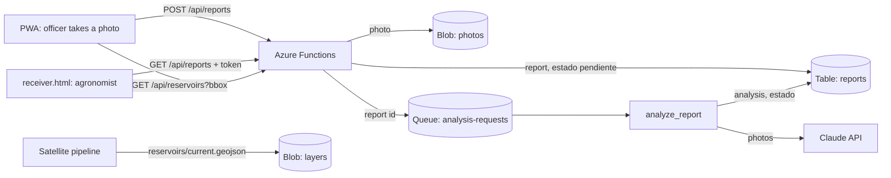

# Gusanito

Early detection of fall armyworm reservoirs: extension officers photograph green dry-season patches, the server analyses each photo with Claude and keeps the result for an agronomist to review. The project proposal is in [`docs/propuesta-gusano-cogollero.md`](docs/propuesta-gusano-cogollero.md).

```
frontend/   PWA (vanilla JS): map with reservoirs, photo report, receiver page, service worker, offline map, dev server
backend/    Azure Functions app (Python 3.13): reports, Claude analysis queue, reservoirs layer, alerts
infra/      Terraform: Function App (Flex Consumption), Storage, Key Vault, Application Insights, Static Web App
```



The PWA gets an acknowledgement as soon as the photo is stored and never sees Claude's answer. The analysis runs from a queue, so a slow or failing Claude call never makes the officer wait, and it is retried automatically.

## API

| Method | Route | Auth | What it does |
|---|---|---|---|
| GET | `/api/health` | none | `{"status": "ok"}` |
| GET | `/api/reservoirs?bbox=lon_min,lat_min,lon_max,lat_max` | none | Reservoirs layer (GeoJSON) for the visible map area. 404 until the pipeline publishes one |
| POST | `/api/reports` | none | Stores a photo report and queues its analysis. 202 new, 200 if that `id` was already received |
| GET | `/api/reports[?reservoirId=]` | token | Reports, newest first |
| GET | `/api/reports/{id}` | token | One report |
| GET | `/api/reports/{id}/photos/{n}` | token | A report photo |
| POST | `/api/alerts/message` | token | Drafts the SMS and voice script of an alert (`riskLevel`, `distanceKm`, `direction`, `daysToAct`, `language`: es/en/ny) |

"token" is `REPORT_TOKEN`, sent as the `x-report-token` header only, never in the URL, where it would land in request logs. The receiver page fetches photos with the header and shows them as blob URLs.

`POST /api/reports` body (camelCase, like the rest of the PWA's JSON):

```json
{
  "id": "0b6f6b8e-6a8f-4f0e-9a4f-2d0b1c3e4f50",
  "reservoirId": "lusaka-0007",
  "label": "armyworm",
  "location": {"lat": -15.4165, "lng": 28.2849, "accuracy": 8},
  "capturedAt": "2026-09-12T08:30:00+02:00",
  "photos": [{"mediaType": "image/jpeg", "data": "<base64>"}],
  "meta": {"name": "IMG_0001.jpg", "originalSize": 2400000, "width": 4032, "height": 3024}
}
```

Only `id` and 1-3 `photos` are required. The PWA generates `id` per photo, so a resend after a dropped connection is never stored twice.

Report `estado`, set by the analysis:

| `estado` | When |
|---|---|
| `pendiente` | Waiting for the analysis |
| `reservorio_confirmado` | Claude sees fall armyworm signs |
| `hospedero_sin_senales` | Host vegetation, no signs |
| `descartado` | Not a host |
| `revision_humana` | Confidence below `MIN_CONFIDENCE` (0.7), Claude asks for review, Claude declined, or host unclear |
| `repetir_fotos` | Photos are unusable |
| `error_analisis` | The analysis failed 5 times, or failed with a non-retryable error |

`agrees` compares Claude with the officer's label. The confidence is self-reported by the model and not calibrated: tune `MIN_CONFIDENCE` with agronomist-labelled photos.

### Reservoirs layer contract (satellite pipeline)

Publish a GeoJSON `FeatureCollection` to the blob `layers/reservoirs/current.geojson` in the storage account. Each feature's `id` is the reservoir id the PWA sends back (letters, digits, `-`, `_`, `.`), and `properties` holds at least `probabilidad` (0-1) and `fecha` (ISO date). `backend/tools/publish_sample_layer.py` publishes three sample patches near Lusaka for local development.

## Run locally

Needs Python 3.13, Node.js, Docker and [Azure Functions Core Tools 4](https://learn.microsoft.com/azure/azure-functions/functions-run-local).

```sh
# 1. Azurite, the Azure Storage emulator
docker run -d --rm --name azurite -p 10000:10000 -p 10001:10001 -p 10002:10002 \
  mcr.microsoft.com/azure-storage/azurite azurite --blobHost 0.0.0.0 --queueHost 0.0.0.0 --tableHost 0.0.0.0

# 2. API
cd backend
python3 -m venv .venv && .venv/bin/pip install -r requirements-dev.txt
cp local.settings.json.example local.settings.json   # set ANTHROPIC_API_KEY; REPORT_TOKEN is dev-token
.venv/bin/python tools/publish_sample_layer.py       # optional: sample reservoirs near Lusaka
source .venv/bin/activate && func start              # http://127.0.0.1:7071

# 3. PWA, receiver page and API on one origin
cd frontend && node dev-server.js                    # http://127.0.0.1:8787, receiver at /receiver.html
```

The offline map is not committed: from `frontend/` run `scripts/make-tiles.sh` (needs the `pmtiles` CLI). Without it the map background is blank, everything else works.

The service worker serves the app shell cache-first: bump `CACHE` in `frontend/sw.js` whenever a cached file changes, or browsers keep the old version.

Tests (the storage ones run only while Azurite is up):

```sh
cd backend && .venv/bin/python -m pytest -q
```

Try the analysis with a real photo (needs `ANTHROPIC_API_KEY` and the host running):

```sh
.venv/bin/python tools/send_photo.py maize.jpg --label armyworm --token dev-token
```

## Deploy to Azure

Needs Terraform >= 1.9, Azure CLI (`az login`), Functions Core Tools and Node.js.

```sh
cd infra
cp terraform.tfvars.example terraform.tfvars   # set subscription_id
terraform init && terraform apply

# The Anthropic key goes straight to Key Vault, so it never lands in the Terraform state
az keyvault secret set --vault-name "$(terraform output -raw key_vault)" --name anthropic-api-key --value "$ANTHROPIC_API_KEY"
az functionapp restart -g "$(terraform output -raw resource_group)" -n "$(terraform output -raw function_app)"

./deploy.sh                          # publishes the API and the PWA (pointed at the Function App)
terraform output -raw report_token   # for the receiver page
```

The Function App reaches Storage with a managed identity (no keys) and reads the Anthropic key through a Key Vault reference. Its CORS allows the Static Web App and the local dev server.

## Known gaps

- **No offline queue for reports yet.** Without signal the PWA asks the officer to retry; the API is ready for it (idempotent `id`).
- **Spend control:** anyone with the PWA can post reports, and each one is analysed. Set a spend limit on the Anthropic workspace whose key you deploy.
- **Receiver auth** is a shared token; use Entra ID for anything beyond the hackathon.
- **Alerts** are drafted (`/api/alerts/message`) but not sent: an SMS provider is still to be wired in.
