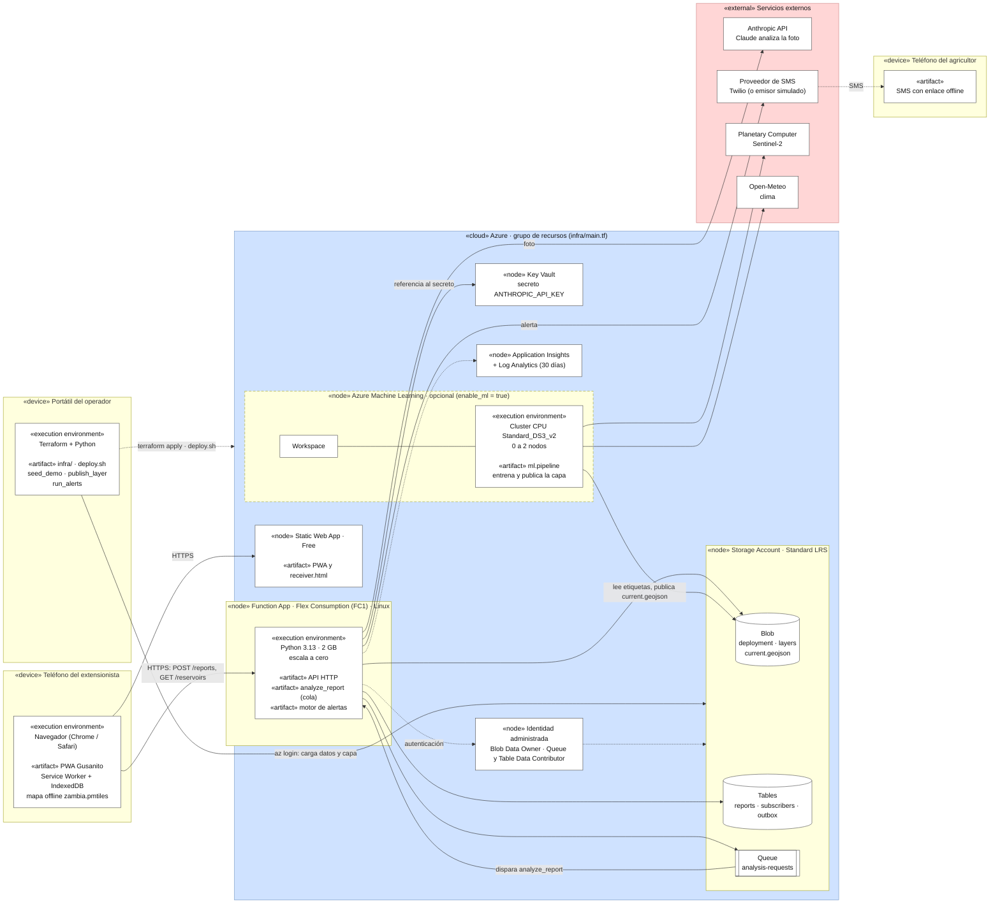

# Diagrama de despliegue

Sale de `infra/main.tf` y `infra/ml.tf`. Para verlo: pega el bloque en [mermaid.live](https://mermaid.live) o ábrelo en un visor de Markdown con Mermaid (GitHub lo dibuja). Mermaid no tiene nodos 3D de UML, así que cada nodo lleva su estereotipo («device», «execution environment», «artifact») en el texto y las zonas van en color: azul para el grupo de recursos de Azure, verde para el entrenamiento, rojo para servicios externos.

## Qué sale de cada archivo de Terraform

| Elemento | Recurso Terraform |
|---|---|
| Static Web App (Free) | `azurerm_static_web_app.pwa` |
| Function App (FC1, Python 3.13, 2 GB) | `azurerm_service_plan.functions`, `azurerm_function_app_flex_consumption.api` |
| Storage Account (LRS) y su contenedor `deployment` | `azurerm_storage_account.main`, `azurerm_storage_container.deployment` |
| Identidad administrada y roles de almacenamiento | `azurerm_user_assigned_identity.functions`, `azurerm_role_assignment.storage` |
| Key Vault con la clave de Anthropic | `azurerm_key_vault.main` |
| Application Insights y Log Analytics | `azurerm_application_insights.main`, `azurerm_log_analytics_workspace.main` |
| Azure ML y cluster que escala a cero, **solo con `enable_ml = true`** (por defecto apagado) | `azurerm_machine_learning_workspace.main`, `azurerm_machine_learning_compute_cluster.cpu`, rol *Storage Blob Data Contributor* para ambos (`infra/ml.tf`) |
| Portátil del operador con acceso a datos (`seed_demo.py`, `publish_layer.py`, `run_alerts.py`) | `azurerm_role_assignment.storage_deployer`: *Blob* y *Table Data Contributor* para quien ejecuta Terraform |

## Lo que no sale de Terraform

Lo puse en el diagrama porque el despliegue real depende de ello, pero Terraform no lo crea:
- Las **tablas** `reports`, `subscribers` y `outbox`, la **cola** `analysis-requests` y el contenedor `layers` los crea el código al arrancar.
- El **proveedor de SMS** es simulado por defecto (`SMS_SENDER` sin definir). Twilio es opcional y no está en `infra/`.
- El **secreto** `ANTHROPIC_API_KEY` en Key Vault se carga a mano (lo dice el README).
- Los datos de **Planetary Computer** y **Open-Meteo** los usa el job de entrenamiento, no la API.
