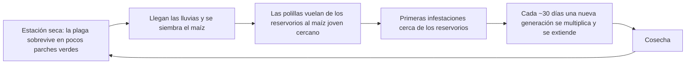
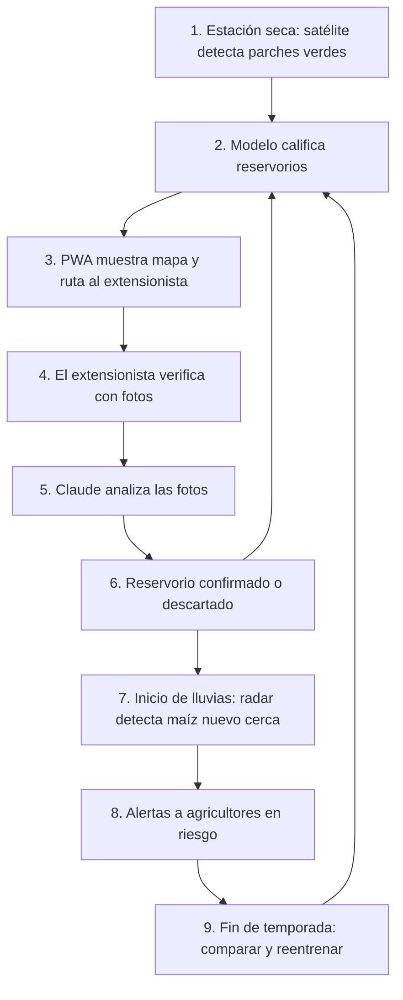

# Propuesta: Alerta temprana de gusano cogollero basada en reservorios

*Nombre de trabajo: "Brasa"*

## 1. Resumen

**Encontramos desde el espacio dónde sobrevive el gusano cogollero durante la estación seca, para frenarlo antes de que empiece la temporada, cuando todavía está en pocos lugares.**

El sistema mapea con imágenes satelitales los parches verdes de la estación seca (los reservorios), los verifica en terreno con fotos analizadas por Claude y avisa a los agricultores cercanos antes de que la plaga se extienda. El usuario principal es el extensionista agrícola, que trabaja desde una PWA. Los agricultores reciben la acción concreta por SMS, voz o radio.

## 2. El problema

El gusano cogollero ataca el maíz de millones de pequeños productores en África cada temporada, y todo el control actual es reactivo: se actúa cuando el daño ya es visible.

- CABI estima pérdidas de **4 a 18 millones de toneladas de maíz al año** (USD 1.000 a 4.600 millones) en 12 países africanos.
- Los agricultores reportan perder **26,6% de su maíz en Ghana y 35% en Zambia**.
- Para cuando el agricultor reconoce la plaga, ya pasó por 2-3 generaciones y está en todo el paisaje.

Los sistemas actuales (PRISE, FAMEWS, detección satelital de daño) trabajan durante la temporada, cuando la plaga ya se extendió.

## 3. El hallazgo clave: los reservorios

En África el gusano cogollero no migra largas distancias como en China o EE.UU.: sobrevive la estación seca en el mismo lugar, concentrado en pocos parches verdes.

Un **reservorio** es un lugar donde la plaga sobrevive cuando no hay cultivo, y desde donde sale a infestar los campos cuando empieza la nueva temporada. Es como la chispa que queda en las brasas después de apagar una fogata.



1. **Temporada de lluvias:** hay maíz por todas partes y la plaga está en todos lados.
2. **Cosecha y estación seca:** el maíz desaparece y casi todo el paisaje se seca. La mayoría de los gusanos muere.
3. **Algunos sobreviven** en lo que sigue verde: maíz con riego, huertos en humedales (los *dambos* de Malawi), pastos silvestres o sorgo.
4. **Vuelven las lluvias:** las polillas salen de los reservorios hacia el maíz recién sembrado que está cerca.

**Por qué creemos que funciona:**

- Gran parte del África subsahariana es apta para la plaga todo el año, y un estudio genético en 22 países encontró que la migración dentro del continente es más limitada de lo esperado.
- En Etiopía el maíz con riego funciona como "puente verde" entre temporadas, y en Mozambique se midió más infestación en la estación seca.
- La FAO ya usa esta lógica con la langosta del desierto: mapas satelitales de vegetación verde cada 10 días desde 2010 para ubicar sus zonas de reproducción. Nadie lo ha aplicado al gusano cogollero.

## 4. La solución

Mapear por satélite los reservorios de estación seca, verificarlos en terreno, predecir qué campos se infestarán primero y actuar antes de que la plaga se extienda.

**Las señales:**

| Señal | Fuente | Para qué |
|---|---|---|
| Áreas verdes en estación seca | Sentinel-2 | Encontrar reservorios. La estación seca tiene cielo despejado |
| Cobertura del suelo | ESA WorldCover | Descartar bosques y vegetación que no hospeda la plaga |
| Humedad del suelo y lluvia | Datos satelitales y climáticos | Saber qué parches siguen verdes y cuándo empieza la temporada de lluvias |
| Temperatura | Datos climáticos | Saber si la plaga se está multiplicando en el reservorio |
| Emergencia del maíz nuevo | Sentinel-1 (radar, ve a través de nubes) | Saber cuándo y dónde aparece maíz joven cerca de un reservorio |

**Usuarios y canales:**

| Usuario | Canal | Qué hace |
|---|---|---|
| Extensionista agrícola | PWA (funciona sin conexión, se instala sin tienda, gasta pocos datos) | Ve el mapa de reservorios y riesgo, sigue una ruta de verificación y reporta con fotos |
| Agricultores líderes | PWA o WhatsApp | Verifican reservorios cercanos y pasan el aviso en persona |
| Todos los agricultores | SMS, voz en idioma local o radio comunitaria | Reciben la acción concreta: "Hay un reservorio confirmado a 2 km de tu campo. Revisa tu maíz esta semana" |

## 5. Flujo completo



### Fase 1: Detectar reservorios (estación seca, cada 5-10 días)

1. **Azure Functions** (programada) baja imágenes **Sentinel-2** del catálogo de **Microsoft Planetary Computer**.
2. Calcula el índice de verdor por píxel y descarta nubes.
3. Filtra bosques y vegetación siempre verde con **ESA WorldCover**.
4. Suma **temperatura, lluvia y humedad del suelo** a cada parche.
5. **Azure ML** asigna a cada parche una **probabilidad de ser reservorio**.
6. El resultado se guarda en **Azure Storage** como capas para el mapa.

### Fase 2: Verificar en terreno

7. El extensionista abre la **PWA**. **Azure Maps** muestra los reservorios probables y le arma una **ruta** que prioriza los parches más grandes y en los que el modelo tiene más dudas.
8. En cada parche toma **2-3 fotos** (vegetación general y plantas de cerca). La PWA guarda el **GPS** y, si no hay señal, deja todo en cola.
9. Cuando hay conexión, la PWA sube las fotos y una **Azure Function** las envía a **Claude en Microsoft Foundry**.
10. Claude devuelve un **JSON de análisis**:
    - **Confianza alta:** el reservorio queda confirmado o descartado.
    - **Confianza baja:** pasa a revisión de un agrónomo.
11. Cada resultado se guarda como **dato etiquetado** para reentrenar el modelo de Azure ML.

### Fase 3: Inicio de la temporada de lluvias

12. Con las nubes de la temporada, el **radar Sentinel-1** detecta **dónde y cuándo emerge el maíz nuevo**.
13. **Azure ML** calcula el **riesgo de cada zona de cultivo** según la distancia a los reservorios confirmados, la edad del maíz y la temperatura.

### Fase 4: Alertas

14. Una **Azure Function** toma las zonas en riesgo y **Claude redacta el mensaje** en lenguaje simple.
15. Los mensajes salen por:
    - **SMS o voz**, a través de un proveedor de SMS (por ejemplo Africa's Talking, que no está en el toolbox de la slide).
    - **PWA**, para extensionistas y agricultores líderes.
    - **Guion semanal** para la radio comunitaria.

### Fase 5: Aprender cada temporada

16. Al final de la temporada se compara **lo que predijo el modelo** con **lo que pasó**: reportes de FAMEWS, verificaciones en terreno y respuestas de los agricultores.
17. **Azure ML se reentrena**, y el mapa del año siguiente sale más preciso.

### Acciones que habilita el flujo

1. **Prevenir en la fuente:** tratar los pocos reservorios antes de la temporada (bioplaguicidas, enemigos naturales) en vez de pelear contra la plaga en cientos de fincas.
2. **Avisar primero** a las fincas cercanas a los reservorios.
3. **Poner trampas donde sirven:** en el borde de los reservorios.
4. **Coordinar la siembra:** evitar sembrar escalonado cerca de los reservorios.

## 6. Claude para analizar las fotos de verificación

Claude está disponible en **Microsoft Foundry**, así que el análisis queda dentro de Azure. Modelo recomendado: **Claude Opus 5.5** (`claude-opus-5-5`). Si el volumen de fotos crece y el costo importa, se puede evaluar Claude Haiku 5.5 con el mismo set de prueba.

**Qué hace bien:**

- Analiza imágenes sin entrenamiento previo, así que sirve desde el primer día.
- Reconoce señales típicas del gusano cogollero: hojas raspadas con aspecto de "ventana", agujeros irregulares, excremento parecido a aserrín en el cogollo y la larva con una "Y" invertida en la cabeza.
- Clasifica el tipo de vegetación (maíz, pasto, sorgo, otra), clave para saber si un parche es hospedero.
- Avisa si la foto no sirve y pide repetirla.
- Entrega un JSON con formato fijo (salidas estructuradas, disponibles en Foundry).

**Límites:**

- No es un clasificador agronómico validado: puede confundir el gusano cogollero con otros gusanos o barrenadores. Hay que evaluarlo con fotos etiquetadas por un agrónomo.
- Necesita conexión: la PWA guarda las fotos y las envía cuando hay señal.
- Los casos con confianza baja van a revisión humana.

**Salida de ejemplo por foto:**

```json
{
  "calidad_foto": "buena",
  "tipo_vegetacion": "maiz",
  "es_hospedero": true,
  "senales_gusano": ["hojas_ventana", "excremento_en_cogollo"],
  "larva_visible": true,
  "severidad": "media",
  "confianza": 0.82,
  "requiere_revision_humana": false,
  "nota_para_extensionista": "Daño reciente en el cogollo. Probable reservorio activo."
}
```

**Nota sobre el toolbox:** la slide lista Azure OpenAI. Recomendamos usar Claude para las dos tareas (analizar fotos y redactar mensajes) para tener un solo proveedor de IA. Hay que confirmar que las reglas del hackathon lo permiten.

## 7. Herramientas por fase

| Fase | Herramientas |
|---|---|
| 1. Detectar reservorios | Planetary Computer (Sentinel-2, WorldCover), Azure Functions, Azure ML, Azure Storage |
| 2. Verificar | PWA, Azure Maps, Azure Functions, Claude en Foundry |
| 3. Inicio de lluvias | Sentinel-1, Azure ML |
| 4. Alertas | Claude en Foundry, proveedor de SMS/voz, PWA |
| 5. Aprender | Azure ML |

## 8. Qué es nuevo

| Ya existe | Lo nuevo |
|---|---|
| PRISE (CABI): predice cuándo con temperatura y avisa por distrito | Predice dónde empieza la infestación de cada temporada |
| ProvEye y estudios con Sentinel-2: detectan daño durante la temporada | Mira la estación seca, antes de que exista daño |
| FAO: mapas de vegetación para la langosta | Misma lógica aplicada por primera vez al gusano cogollero |
| Control reactivo en todo el paisaje | Prevención concentrada en pocos puntos |

## 9. Impacto esperado

- **Evidencia de la langosta:** un modelo de Magor, Lecoq y Hunter (2008) muestra que controlar desde el inicio de un brote, incluso con una tasa conservadora, reduce el tamaño de los brotes y las plagas. El mismo estudio indica que la prevención funciona mejor cuando los reservorios son pequeños y accesibles, como los del gusano, que están dentro de zonas agrícolas.
- **Lo que cuesta llegar tarde:** en la plaga de langosta de 2003-2005, el costo de control pasó de USD 1 millón a USD 50-100 millones en un año. El brote 2019-2021 empezó porque tres generaciones se reprodujeron sin ser detectadas y terminó en 2,3 millones de hectáreas fumigadas.
- **Escenario ilustrativo:** si se redujeran las pérdidas apenas un 10%, el ahorro sería de USD 100 a 460 millones al año en 12 países. Es una suposición que hay que validar.
- **Beneficios adicionales:** menos plaguicida, menos costo para los extensionistas y más tiempo para reaccionar.
- **El impacto se repite cada año**, porque la plaga ataca en cada temporada.

## 10. MVP y validación

- **Alcance:** 1 distrito (por ejemplo Kasungu, Malawi) y 1 estación seca.
- **Validación histórica con FAMEWS:** ¿las primeras infestaciones de cada temporada aparecieron cerca de los parches verdes de la estación seca anterior?
- **Evaluación de Claude:** un set de 100-200 fotos etiquetadas por un agrónomo (con y sin gusano, maíz y otros pastos) para medir cuánto acierta.
- **Demo:** mapa animado de una temporada pasada que muestra los reservorios en la estación seca y cómo la infestación partió desde ellos.

## 11. Riesgos y mitigaciones

| Riesgo | Mitigación |
|---|---|
| No está medido cuánto de la infestación viene de los reservorios cercanos | Es la hipótesis central; la validación con FAMEWS la pone a prueba |
| Los pastos silvestres pueden ser reservorios difíciles de distinguir | Usar la vegetación verde en general como señal y refinar con las verificaciones |
| Falsas alarmas que hacen perder confianza | Filtrar con cobertura del suelo y verificar antes de pedir acciones costosas |
| Claude confunde el gusano con otras plagas | Evaluación con fotos etiquetadas y revisión humana de casos dudosos |
| Una alerta sin respuesta no sirve (lección de la langosta en 2003) | Conectar el sistema a quienes actúan: extensionistas, agricultores líderes y canales como PRISE |

## 12. Fuentes

- [CABI - PRISE](https://www.cabi.org/projects/prise-a-pest-risk-information-service/)
- [JIPM - Paper técnico de PRISE](https://academic.oup.com/jipm/article/15/1/7/7585279)
- [Banco Mundial - ProvEye, detección satelital en Malawi](https://www.worldbank.org/en/data/statistical-capacity-building/data-innovation-fund/armyworm-research-using-remote-sensing-methods)
- [MDPI - Monitoreo regional con Sentinel-2](https://doi.org/10.3390/rs14195003)
- [ScienceDirect - Detección con Sentinel-2 en etapas vegetativas (2025)](https://www.sciencedirect.com/science/article/pii/S1569843225001633)
- [FAO - FAMEWS](https://sti-portal.fao.org/innovations/fall-armyworm-monitoring-and-early-warning-system-famews)
- [PMC - Migración limitada en África (Nagoshi et al. 2022)](https://pmc.ncbi.nlm.nih.gov/articles/PMC8816908)
- [Frontiers 2026 - Puente verde en Koga, Etiopía](https://www.frontiersin.org/journals/plant-science/articles/10.3389/fpls.2026.1768817/full)
- [PMC - Estación seca en Manica, Mozambique](https://www.ncbi.nlm.nih.gov/pmc/articles/PMC7469179/)
- [icipe - Plantas hospederas en Benín](https://thehive.icipe.org/all-prp/1634)
- [JRC - Mapas de vegetación verde para la langosta](https://publications.jrc.ec.europa.eu/repository/handle/JRC68835)
- [Universidad de Greenwich - Magor, Lecoq y Hunter (2008)](https://gala.gre.ac.uk/id/eprint/9139)
- [FAO - Crisis de langosta 2020-2021](https://www.fao.org/emergencies/crisis/desertlocust/en/)
- [HopperWiki - Brote 2019-2021](https://hopperwiki.org/index.php/2019-2021_desert_locust_outbreak_and_preventative_management)
- [MDPI Agronomy - Intervención temprana contra la langosta](https://doi.org/10.3390/agronomy11020312)
- [All About Feed - Estimación de pérdidas de CABI](https://www.allaboutfeed.net/animal-feed/raw-materials/progress-made-on-controlling-fall-armyworm)
